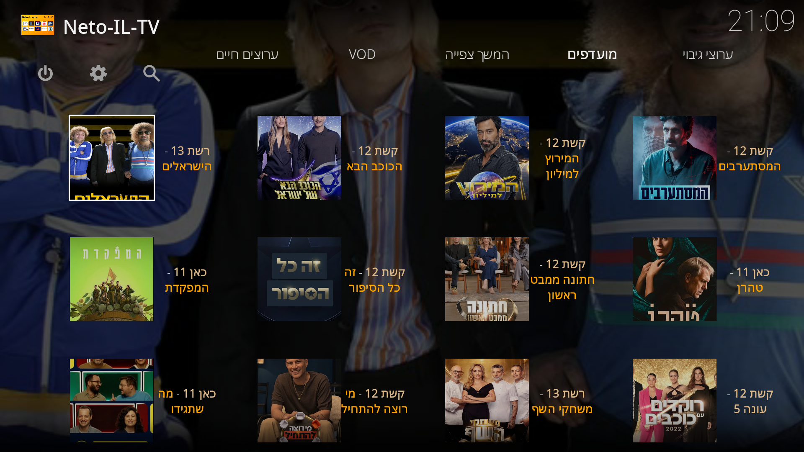
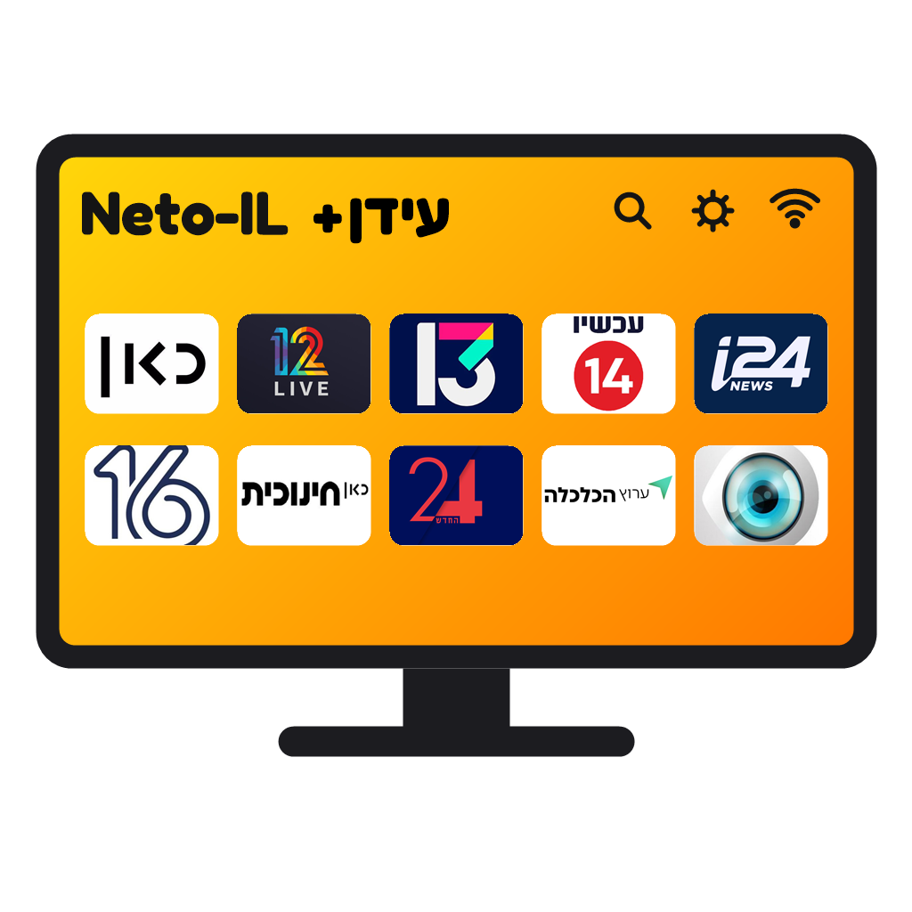
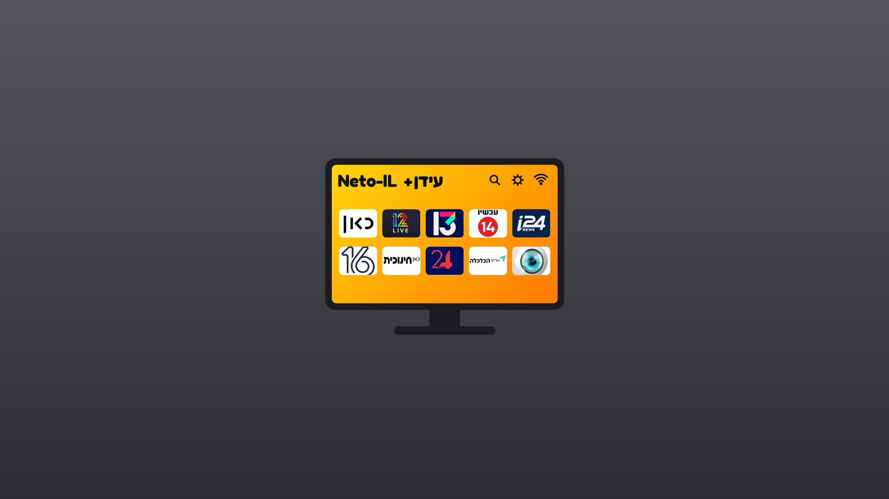

# Neto-IL-TV

Kodi עם התוסף עידן+ בלבד, בסקין [DockIL](https://github.com/OrenDdp/DockIL): בראש העמוד Dock של הקטגוריות (ערוצים חיים, המשך צפייה, מועדפים, VOD, ערוצי גיבוי), ומתחתיו גריד ברוחב כל המסך.

> **הבהרה:** Neto-IL-TV הוא פרויקט פרטי ולא רשמי. הוא לא קשור לעידן+, ל־Fishenzon, ל־Kodi / XBMC Foundation, ל־POV או לאף ערוץ, ולא מאושר על ידם.
> הוא לא מכיל ולא מאחסן שום תוכן: כל השידורים וה־VOD מגיעים ישירות מהאתרים הרשמיים של הערוצים, דרך התוסף עידן+ של Fishenzon.
> בעל זכויות שרוצה שמשהו יוסר מכאן מוזמן לפתוח Issue.

התוסף עידן+ עצמו לא נמצא כאן. הוא של [Fishenzon](https://github.com/Fishenzon/repo), ומותקן אוטומטית מהמאגר שלו בהפעלה הראשונה (צריך חיבור לאינטרנט).

## התקנה

### אנדרואיד TV (Mi Box וכו')
באפליקציית **Downloader** מקלידים את הקוד **2738779**. הוא מוריד תמיד את הגרסה האחרונה.

או מורידים ישירות: [Neto-IL-TV-android.apk](https://github.com/OrenDdp/Neto-IL-TV/releases/latest/download/Neto-IL-TV-android.apk). מותקן לצד Kodi רגיל ולא נוגע בו.

### LG webOS
מורידים אחד מקובצי ה־IPK מ־[Releases](../../releases/latest) ומתקינים במצב מפתחים (webOS Dev Manager, או `ares-install`).
שני הקבצים נראים אותו דבר מאז 1.0.31; הם שתי אפליקציות נפרדות (`lg-dock` ו־`lg-tabs`) רק כדי שמי שהתקין אחת מהן יקבל עדכון.

### Kodi רגיל (21 ומעלה)
1. הגדרות > מערכת > הרחבות: להפעיל **מקורות לא ידועים**.
2. מנהל קבצים > הוסף מקור: `https://orenddp.github.io/Neto-IL-TV/`
3. הרחבות > התקנה מקובץ zip > המקור שהוספת > `repository.netotv-1.0.0.zip`
4. הרחבות > התקנה ממאגר > **Neto-IL-TV repository** > **Neto-IL-TV** > התקן.

Neto-IL-TV מוריד את עידן+, מעביר את Kodi לעברית ולסקין שלו, ומוסיף את הלשוניות.

## בשלט
- **Back** בזמן צפייה: עוצר וחוזר לרשימה.
- **Back** בתפריט הצד: מסתיר את האפליקציה.
- **כפתור אדום** (בשלט LG): תפריט הפריט, למשל "הוסף למועדפי עידן פלוס".
- סוג התצוגה של כל לשונית: גלגל שיניים > Skin settings > פריטי תפריט ראשי > Set widgets > Widget 1 > Display type.

## סנכרון "המשך צפייה" בין כמה מכשירים
אפשר לסנכרן את "המשך צפייה" של עידן+ בין כמה מכשירים בבית, דרך תיקייה משותפת ברשת, למשל שיתוף SMB בשרת או ב־NAS.
מה שעצרת בחדר ממשיך מאותה נקודה בסלון.
1. מכינים תיקייה משותפת שכל המכשירים יכולים לכתוב אליה.
2. בכל מכשיר נכנסים להרחבות > הרחבות שלי > שירותים > **Neto-IL-TV** > הגדרות, וממלאים את **Idan Plus sync folder**.
   לדוגמה: `smb://192.168.1.5/kodi-sync/idanplus/`.
3. מפעילים את האפליקציה מחדש.

כל מכשיר כותב לתיקייה רק את הקובץ שלו, וממזג אליו את מה שנצפה במכשירים האחרים. לכל פרק נשמרת הצפייה האחרונה.
אם התיקייה לא זמינה, הכל ממשיך לעבוד כרגיל. הקוד (`idansync.py`) זהה לזה של התוסף הנלווה ל־DockIL ב־Kodi POV IL,
כך שאפשר לסנכרן גם בין Neto-IL-TV ל־POV IL.

## מה יש כאן
| תיקייה | מה |
|---|---|
| `src/service.netotv` | מתקין את עידן+, מגדיר את Kodi ורושם את הלשוניות |
| `src/plugin.video.netotv` | מפצל את הערוצים החיים לערוצים רגילים וערוצי גיבוי |
| `src/skin.dockil` | הסקין [DockIL](https://github.com/OrenDdp/DockIL), מבוסס [FENtastic](https://github.com/ivarbrandt/skin.fentastic) של Ivar Brandt (GPL-2.0 / CC BY-SA 4.0). כשהשירות של Neto-IL-TV מותקן הוא מציג רק את ה־Dock של עידן+, עם הלוגו של Neto-IL-TV |
| `src/script.fentastic.helper` | העוזר של FENtastic (GPL-2.0), עם ברירות המחדל של הלשוניות ותצוגות Grid |
| `kodi-changes/` | כל מה ששונה ב־Kodi עצמו, כ־diff מול הגרסה הרשמית |
| `docs/` | מאגר ה־Kodi (GitHub Pages) |
| `tools/`, `webos/`, `build.sh` | בניית הלשוניות, הלוגו, המאגר, ה־APK וה־IPK |

## רישיונות
- קבצי ההתקנה מבוססים על [Kodi](https://kodi.tv) הרשמי (GPL-2.0); הקוד המלא ב־[xbmc/xbmc](https://github.com/xbmc/xbmc), והשינויים שלנו ב־`kodi-changes/`. "Kodi" הוא סימן מסחרי של XBMC Foundation; Neto-IL-TV לא משתמש בשם או בלוגו של Kodi כשם המוצר.
- FENtastic והעוזר שלו: GPL-2.0 (קוד), CC BY-SA 4.0 (גרפיקה), של Ivar Brandt ו־Tikipeter.
- הפונט Rubik: SIL Open Font License 1.1 (`src/skin.dockil/fonts/rubik_license.txt`). הפונט הקודם נשאר לבחירה בשם "Noto" (הגדרות > ממשק > סקין > פונטים).
- הקוד שלנו (`src/service.netotv`, `src/plugin.video.netotv`, `tools/`, `webos/`): GPL-2.0.
